# RECABRA · Pantallas nuevas y sus funciones

26 de octubre de 2026 · Brayan

El sistema nuevo tiene 4 módulos (Contratos, Indicadores, Montajes, Plano de la sede), una barra común y Ajustes. Cada pantalla trae su propósito en una línea y la lista completa de funciones para marcar a medida que se implementan. Cubre las 187 funciones de hoy más las nuevas de los dibujos aprobables.

## Mapa del sistema

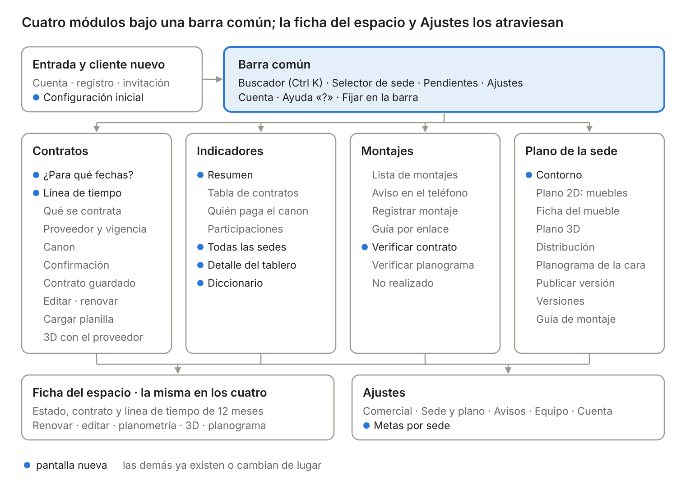

Todo se entra por la barra común; cada módulo agrupa sus pantallas, y la ficha del espacio y Ajustes sirven a los cuatro. Las pantallas marcadas son nuevas; el resto existe hoy o cambia de lugar.

## Elementos comunes

Están en todas las pantallas: la barra, la bandeja de Pendientes, la ficha del espacio y la ayuda. Se construyen una vez y los usan los cuatro módulos.

### Barra superior

Navegación de un solo nivel, siempre visible. **Estado:** nueva (reemplaza las pestañas Sede, Montajes, Plano y Editor 3D).

*Dibujo.*

- [ ] Módulos: Contratos · Indicadores · Montajes · Plano de la sede
- [ ] Plataforma, sólo para el operador
- [ ] Selector de sede, con la opción «Todas las sedes»
- [ ] Botón Pendientes con el contador de pendientes
- [ ] Ajustes (engranaje)
- [ ] Estado de sincronización («Guardado / Guardando / Sin conexión»); un clic sincroniza y reemplaza a «Actualizar»
- [ ] Aviso de conflicto de sincronización, sólo cuando ocurre («Usar la del servidor / Conservar la mía»)
- [ ] Menú de la cuenta: persona y rol, tema claro u oscuro, cambiar de supermercado, cerrar sesión
- [ ] Avisos de cuenta cuando aplican: pago pendiente, política nueva, cuenta suspendida
- [ ] En el teléfono: barra inferior con Contratos, Indicadores, Montajes, Plano y Ajustes

### Buscador de funciones (Ctrl K)

Encuentra cualquier función, espacio o término por su nombre. **Estado:** nuevo.

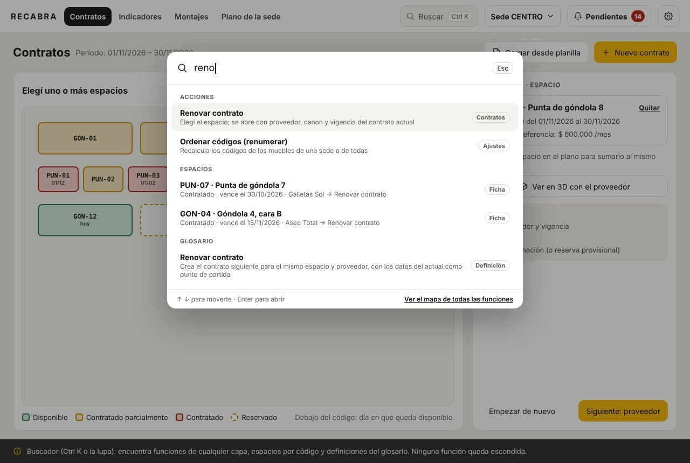

*Dibujo.*

- [ ] Abrir con Ctrl K o con la lupa
- [ ] Resultados agrupados: Acciones · Espacios · Glosario
- [ ] Sinónimos («planilla» encuentra «Cargar contratos desde planilla»; «reno» encuentra «Renovar contrato» y «Ordenar códigos»)
- [ ] Un espacio por código, con su estado y la acción que corresponde («PUN-07 · vence el 30/10/2026 → Renovar contrato»)
- [ ] Moverse con ↑ ↓, abrir con Enter, cerrar con Esc
- [ ] Enlace «Ver el mapa de todas las funciones»

### Bandeja de Pendientes

Lo que hay que resolver, aparte de los módulos: se abre encima de la pantalla en uso. **Estado:** cambia (hoy es «Para revisar» dentro de Supervisar).

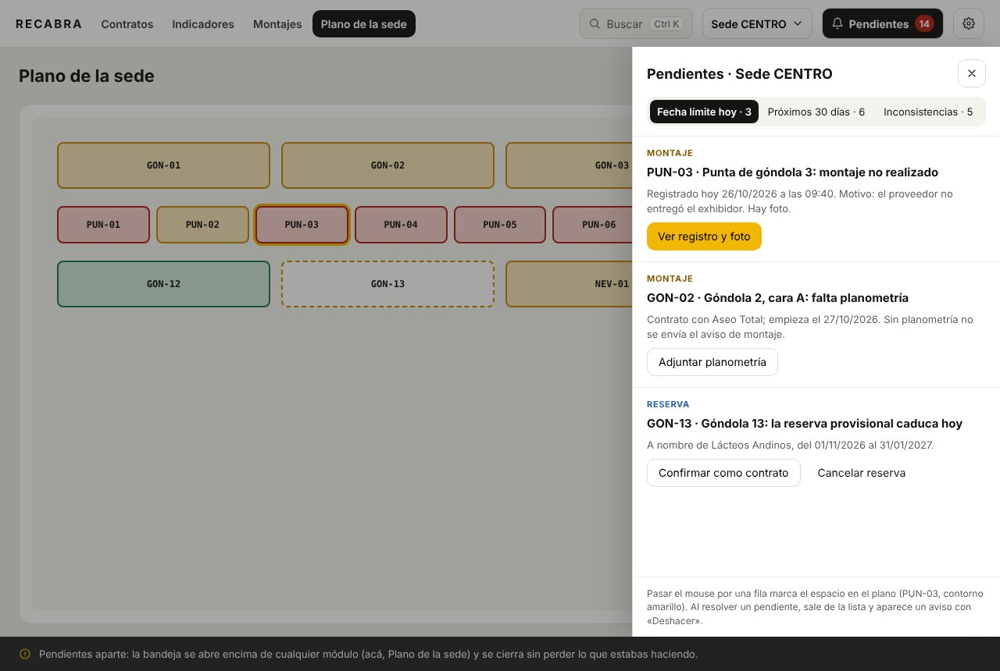

*Dibujo.*

- [ ] Tres pestañas: Fecha límite hoy · Próximos 30 días · Inconsistencias, cada una con su conteo
- [ ] Cada pendiente con su acción y el espacio marcado en el plano al pasar el mouse
- [ ] Al resolverlo sale de la lista y aparece un aviso con «Deshacer»
- [ ] Se abre sola al primer ingreso del día si hay algo con fecha límite hoy
- [ ] Tipos de pendiente:
  - [ ] Contrato vencido
  - [ ] Contrato por vencer en 30 días (Renovar contrato · No renovar)
  - [ ] Reserva provisional por confirmar o que caduca (Confirmar como contrato · Cancelar reserva)
  - [ ] Falta planometría (Adjuntar planometría)
  - [ ] Contratado sin montar
  - [ ] Montaje no realizado, con motivo y foto
  - [ ] Montado, sin verificar (contrato y planograma)
  - [ ] Planograma que no coincide · planograma sin montar · guía por enviar
  - [ ] Participación sin ubicar en la cara · borrador de distribución · reserva de participación que caduca
  - [ ] Ventas por cargar (cobro por % de las ventas)
  - [ ] Volver a llamar a un proveedor (fecha anotada en una oferta)
- [ ] Inconsistencias, cada una con la acción que la corrige:
  - [ ] Canon sin base (mensual o total): «Es al mes / Es el total / Todos son al mes / Deshacer»
  - [ ] Contrato sin mueble en el plano (cancelar el contrato de la base)
  - [ ] Contrato que sólo vive en el plano (pasarlo a la base)
  - [ ] Ocupado sin contrato
  - [ ] Reservado a mano (Liberar · Reservar de verdad)
  - [ ] Canon bajo la tarifa (Editar contrato)
  - [ ] Montajes viejos sin reporte

### Ficha del espacio

La misma ficha en todos los módulos, al tocar un espacio. **Estado:** cambia (hoy hay globo, ficha de Supervisar y panel del Plano).

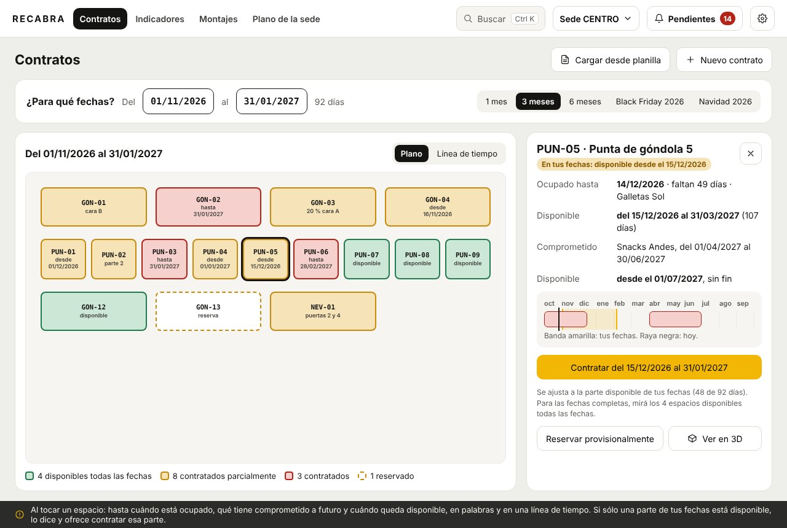

*Dibujo.*

- [ ] Encabezado: código · nombre, estado en el período elegido y fecha («Contratado · vence el 30/10/2026»)
- [ ] Datos: proveedor y marca, vigencia, canon mensual y valor total, estado del montaje, observación; cara A/B con el proveedor de la otra cara
- [ ] Acción principal según el estado: Renovar contrato · Nuevo contrato · Confirmar la reserva
- [ ] A la vista: Editar contrato (o el próximo) · Ver en 3D
- [ ] Línea de tiempo de 12 meses: hasta cuándo está ocupado, qué tiene comprometido a futuro y desde cuándo queda disponible
- [ ] Montaje y documentos: planometría (adjuntar, cambiar, quitar), archivos del contrato (ver, descargar)
- [ ] Partes y participaciones, sólo cuando aplican: renovar, editar, contratar lo disponible, cancelar una parte, distribuir
- [ ] Exhibición: Ver en 3D · Distribuir la cara · Planograma de la cara
- [ ] Plegado «Otras acciones del contrato»: contrato con otro proveedor, negociar el espacio, cancelar el contrato (con confirmación)
- [ ] En el teléfono: hoja que sube desde abajo, con lo mismo

### Ayuda y fijar en la barra

Lo que hace que ninguna función quede escondida. **Estado:** nuevo.

- [ ] «?» en cada pantalla: qué hace y la definición de cada término que aparece
- [ ] «?» en cada cifra: fórmula, período, comparación y meta (diccionario de métricas)
- [ ] Menú «Más» de cada módulo, sólo con lo raro o peligroso
- [ ] Fijar en la barra: cada persona sube hasta 3 funciones de «Más» a su barra; no cambia lo que ven los demás

## Entrada y cliente nuevo

Un supermercado nuevo pasa por cuatro pantallas antes de operar; las tres primeras ya existen y la configuración inicial es nueva.

### Crear cuenta e ingresar

La puerta de entrada para todos los roles. **Estado:** existe.

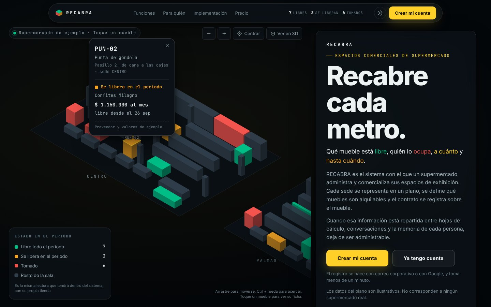

*Captura del sistema actual.*

- [ ] Página pública: «Crear mi cuenta» · «Ya tengo cuenta»
- [ ] Ingresar con Google, o con correo y contraseña
- [ ] Crear cuenta con correo y verificarlo; reenviar el correo de verificación
- [ ] Olvidé mi contraseña
- [ ] Elegir supermercado cuando la persona está en más de uno
- [ ] Política de Tratamiento de Datos y su aceptación

### Registrar un supermercado

Quien lo registra queda como dueño. **Estado:** existe.

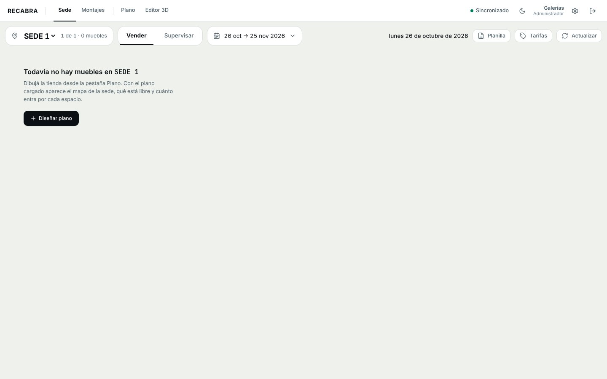

*Captura del sistema actual.*

- [ ] «Registrar un supermercado nuevo»: nombre y aceptación de la política → «Crear y entrar»
- [ ] Topes: 2 supermercados por persona, freno por IP

### Aceptar una invitación

Suma a la persona al supermercado que la invitó, sin fundar otro. **Estado:** existe.

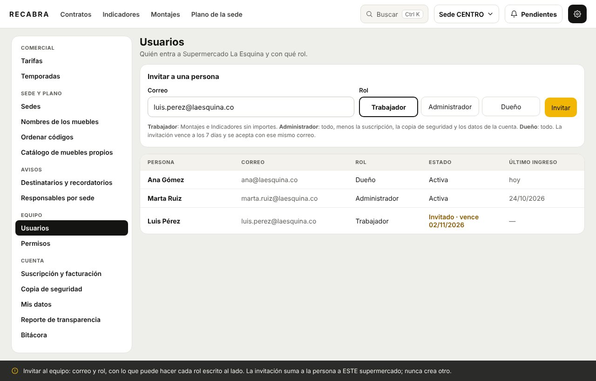

*Dibujo. Es la misma pantalla de Ajustes → Equipo.*

- [ ] Entrar desde el enlace del correo; se canjea con el mismo correo invitado
- [ ] «Continuar sin la invitación» · «Ingresar con otra cuenta»
- [ ] Aviso cuando la invitación venció (dura 7 días)

### Configuración inicial

La primera pantalla de un supermercado nuevo: seis pasos con avance. **Estado:** nueva.

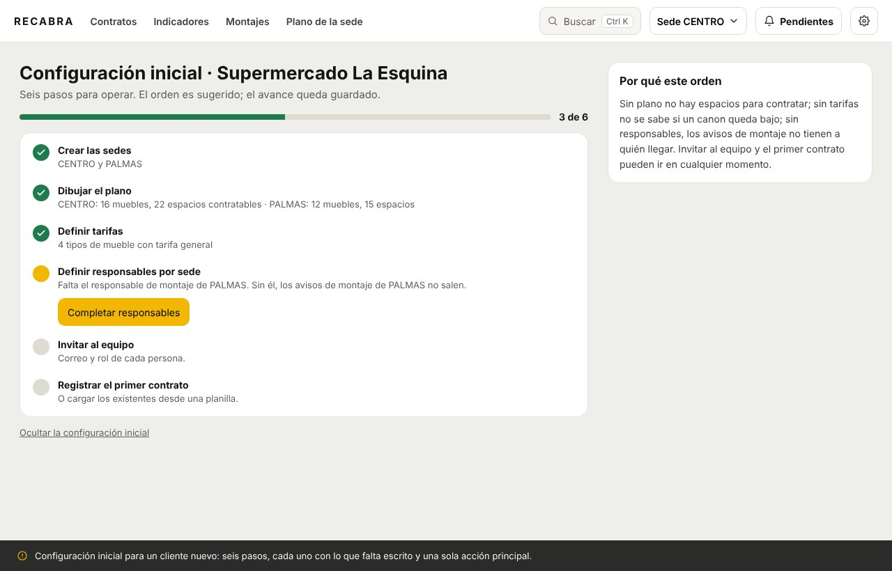

*Dibujo.*

- [ ] Barra de avance «N de 6» y el siguiente paso marcado con la única acción amarilla
- [ ] Paso 1 · Crear las sedes
- [ ] Paso 2 · Dibujar el plano de cada sede (lleva a Plano de la sede); muestra muebles y espacios contratables
- [ ] Paso 3 · Definir las tarifas (lleva a Ajustes › Tarifas)
- [ ] Paso 4 · Definir responsables por sede (comercial, administración, montaje); avisa qué avisos no salen si falta alguno
- [ ] Paso 5 · Invitar al equipo (lleva a Ajustes › Usuarios)
- [ ] Paso 6 · Registrar el primer contrato o cargar los existentes desde planilla
- [ ] Cada paso dice lo que falta y lo ya hecho («CENTRO: 16 muebles, 22 espacios contratables»)
- [ ] Ocultar la configuración inicial y volver a ella desde Ajustes

## Indicadores

El tablero del administrador: un panel rápido de 7 tarjetas como pestaña «Resumen» y tres pestañas de detalle. El trabajador ve una versión sin importes.

### Resumen (panel de información rápida)

Cómo va la sede y qué hacer hoy, en una pantalla sin desplazarse. **Estado:** nueva (reemplaza el Dashboard de Supervisar).

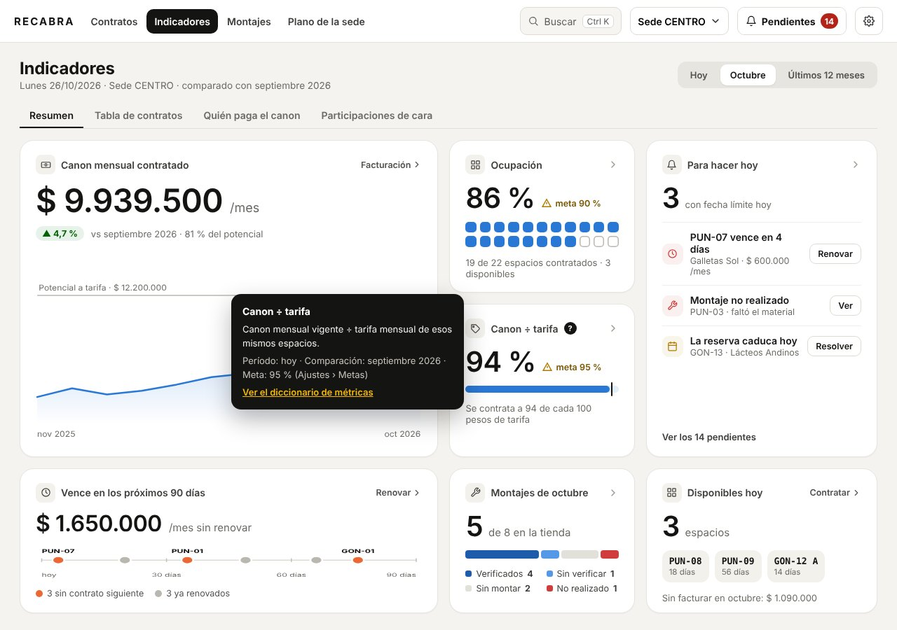

*Dibujo. Se ve abierta la ayuda «?» de una métrica.*

- [ ] Período: Hoy · Mes · Últimos 12 meses; comparación con el mes anterior
- [ ] Tarjeta Canon mensual contratado: valor, variación vs el mes anterior, % del potencial a tarifa, curva de 12 meses contra el potencial → Tabla de contratos
- [ ] Tarjeta Ocupación: %, un cuadrito por espacio (contratados y disponibles), meta → Contratos con el plano por disponibilidad
- [ ] Tarjeta Canon ÷ tarifa: %, barra con la marca de la meta → Tabla de contratos ordenada por ÷ tarifa
- [ ] Tarjeta Para hacer hoy: conteo y las 3 tareas con fecha límite hoy, cada una con su botón → Pendientes
- [ ] Tarjeta Vence en 90 días: canon sin renovar, cada contrato como punto sobre el eje de días (naranja sin renovación, gris renovado) → Tabla filtrada
- [ ] Tarjeta Montajes del mes: N de M en la tienda, barra por estado (verificado, sin verificar, sin montar, no realizado) → Montajes
- [ ] Tarjeta Disponibles hoy: cantidad, códigos con días sin contrato, lo no facturado en el mes → Contratos con esos espacios elegidos
- [ ] «?» en cada tarjeta con la definición de la métrica (diccionario)
- [ ] Estado contra la meta sólo con ícono y texto («Bajo la meta de 90 %»), nunca sólo color
- [ ] Importes completos, sin abreviar («$ 9.939.500»)
- [ ] Versión del trabajador: sin importes; sus montajes, los disponibles y lo que vence
- [ ] Teléfono: canon, ocupación, canon ÷ tarifa y las tareas de hoy

### Tabla de contratos

Todos los contratos de la sede, para buscar, filtrar y exportar. **Estado:** cambia (hoy es «Estado por espacio»).

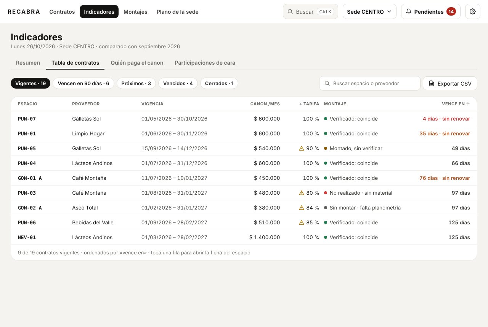

*Dibujo.*

- [ ] Filtros en botones: Vigentes · Vencen en 90 días · Próximos · Vencidos · Cerrados, con conteo
- [ ] Buscar por espacio o proveedor
- [ ] Columnas: espacio, proveedor, vigencia, canon /mes, canon ÷ tarifa, montaje, vence en
- [ ] Ordenar por cualquier columna; marca de «sin renovar» en lo que vence
- [ ] Tocar una fila abre la ficha del espacio
- [ ] Exportar CSV

### Quién paga el canon

De qué proveedores depende la sede. **Estado:** existe (pasa a pestaña).

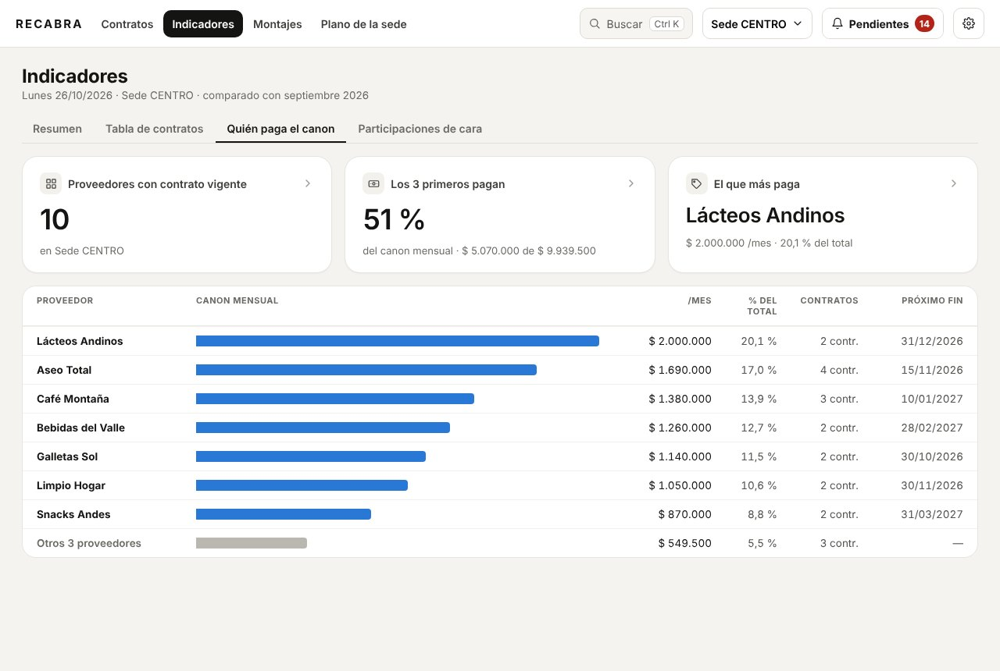

*Dibujo.*

- [ ] Tres cifras: proveedores con contrato vigente, cuánto pagan los 3 primeros, el que más paga
- [ ] Proveedores ordenados por canon mensual, en barras de un solo color; los pequeños en «Otros»
- [ ] Por proveedor: canon /mes, % del total, contratos, próximo fin
- [ ] Orden por monto o por nombre
- [ ] Exportar CSV

### Participaciones de cara

Cómo se reparte cada cara que se contrata por porcentaje. **Estado:** existe (pasa a pestaña).

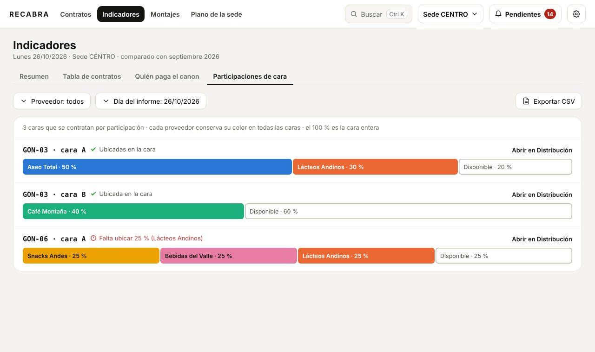

*Dibujo.*

- [ ] Cada cara como una barra del 100 % con el % de cada proveedor y lo disponible
- [ ] Cada proveedor conserva su color en todas las caras
- [ ] Marca de «Falta ubicar» cuando hay una participación sin zona
- [ ] Filtro por proveedor y día del informe; desde / hasta
- [ ] «Abrir en Distribución» por cara
- [ ] Exportar CSV

### Todas las sedes

La misma lectura para un supermercado con varias sedes; se elige en el selector de sede. **Estado:** nueva.

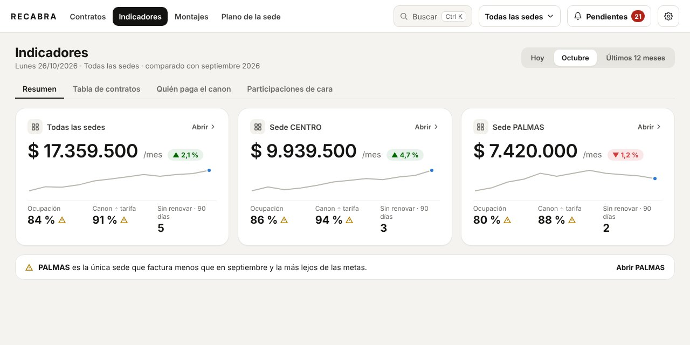

*Dibujo.*

- [ ] Una tarjeta para el total y una por sede
- [ ] Por tarjeta: canon mensual con variación, curva de 12 meses, ocupación, canon ÷ tarifa, sin renovar a 90 días
- [ ] Una frase que dice qué sede necesita atención y por qué
- [ ] «Abrir» lleva al Resumen de esa sede

### Detalle del tablero

El tablero completo de cuatro bloques, al que llevan las tarjetas. **Estado:** nuevo.

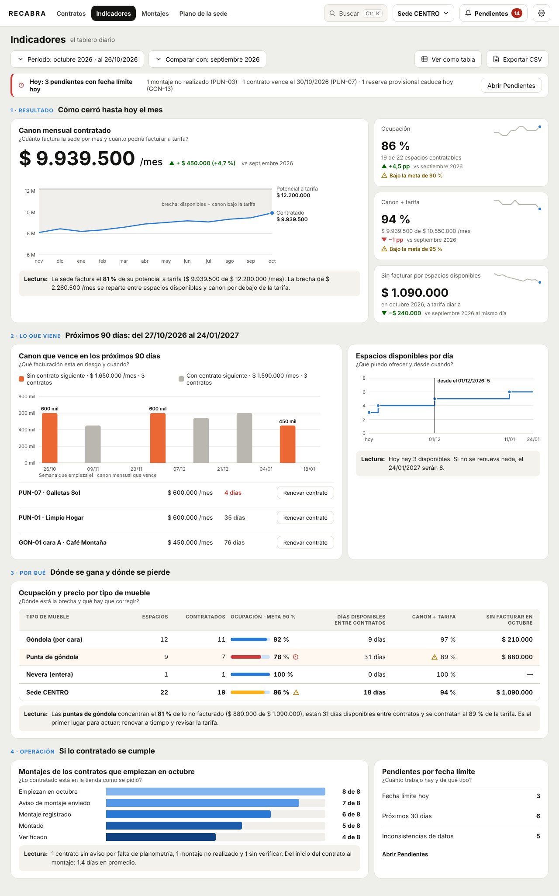

*Dibujo.*

- [ ] Resultado: canon contra potencial, ocupación, canon ÷ tarifa, lo no facturado
- [ ] Lo que viene: canon que vence por semana (con y sin contrato siguiente), espacios disponibles por día a 90 días
- [ ] Por qué: tabla por tipo de mueble (espacios, contratados, ocupación con meta, días disponibles entre contratos, canon ÷ tarifa, lo no facturado)
- [ ] Operación: embudo de montajes del mes (empiezan, aviso enviado, registrado, montado, verificado) y pendientes por fecha límite
- [ ] Una lectura escrita al pie de cada bloque
- [ ] Ver como tabla y exportar CSV

### Diccionario de métricas

La definición exacta de cada cifra, abierta desde el «?». **Estado:** nuevo.

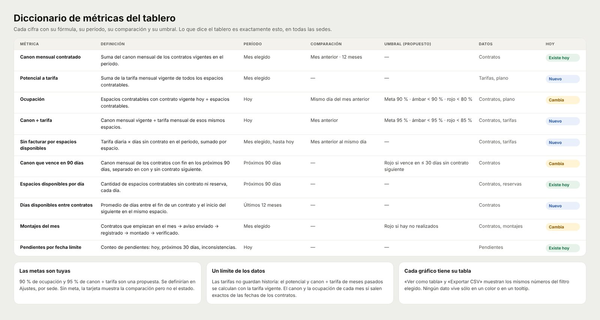

*Dibujo.*

- [ ] Por métrica: fórmula, período, comparación, umbral, datos de origen
- [ ] Métricas: canon mensual contratado, potencial a tarifa, ocupación, canon ÷ tarifa, sin facturar por espacios disponibles, canon que vence en 90 días, espacios disponibles por día, días disponibles entre contratos, montajes del mes, pendientes por fecha límite

## Contratos

Donde se vende: primero las fechas, después el espacio y el contrato en 4 pasos. Reemplaza el modo Vender de la pestaña Sede.

### Contratos: ¿para qué fechas?

La pantalla de entrada: el proveedor pide fechas y el sistema contesta qué está disponible. **Estado:** nueva.

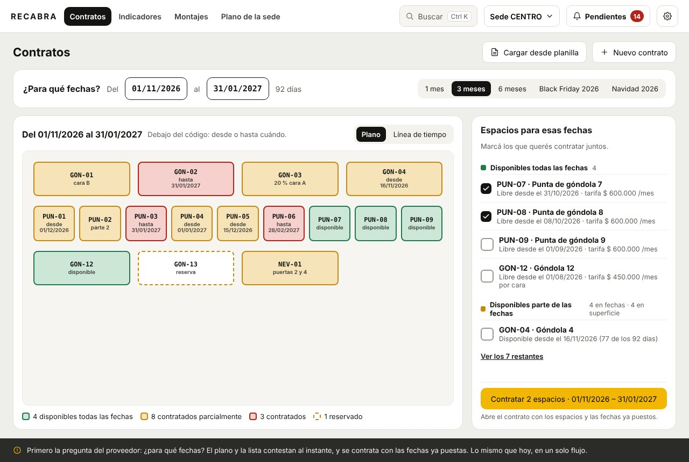

*Dibujo.*

- [ ] Primera línea «¿Para qué fechas?»: del / al, con los días que suman
- [ ] Atajos: 1 mes · 3 meses · 6 meses · cada temporada (Black Friday, Navidad…)
- [ ] Plano con el resultado: verde disponible todas las fechas, ámbar contratado parcialmente (en fechas o en superficie), rojo contratado, borde punteado reservado
- [ ] Debajo de cada código: «disponible», «desde 16/11/2026», «hasta 31/01/2027» o qué parte («cara B», «20 % cara A»)
- [ ] Ver el plano por: Disponibilidad · Fecha en que se libera · Tarifa
- [ ] Clave con conteos («4 disponibles todas las fechas · 8 contratados parcialmente…»)
- [ ] Lista «Espacios para esas fechas»: disponibles todas las fechas y disponibles parte (cuántos días de los pedidos cubren), con tarifa
- [ ] Marcar varios espacios y «Contratar N espacios · del … al …» con las fechas ya puestas
- [ ] Mover y acercar el plano (arrastrar, rueda, dos dedos); filtrar por código o proveedor
- [ ] Cambiar a Línea de tiempo
- [ ] Cargar desde planilla · Nuevo contrato (sin fechas previas)
- [ ] Teléfono: las fechas arriba y la lista; «Ver en el plano»

### Línea de tiempo de la sede

Cada espacio en una fila y 12 meses a la vista: cuánto dura cada contrato y dónde hay huecos. **Estado:** nueva.

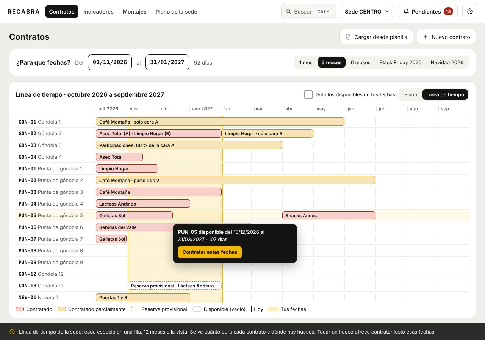

*Dibujo.*

- [ ] Barras por contrato con el proveedor; contratado parcialmente en ámbar; reserva provisional punteada
- [ ] Raya de hoy y banda de las fechas elegidas
- [ ] Tocar un hueco: «PUN-05 disponible del 15/12/2026 al 31/03/2027 · 107 días · Contratar estas fechas»
- [ ] «Sólo los disponibles en tus fechas»
- [ ] Escalera «Cuándo se libera cada espacio» (cuántos quedan disponibles desde cada fecha), con cursor y teclado

### Nuevo contrato · paso 1: qué se contrata

Depende de cómo se configuró el mueble en el plano. **Estado:** cambia.

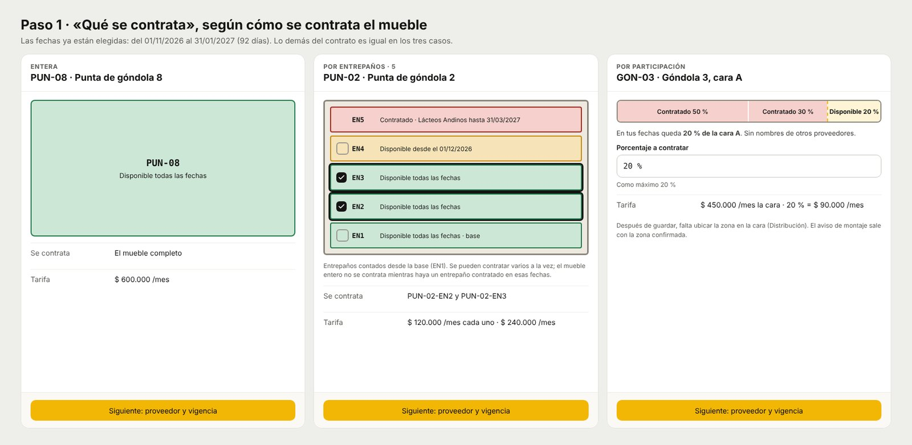

*Dibujo: entero, por entrepaño y por porcentaje.*

- [ ] Entera: el mueble o la cara completa, con su tarifa
- [ ] Por partes: el mueble muestra sus partes (entrepaños desde la base EN1, tramos, puertas), cada una con su disponibilidad; marcar varias; la tarifa por parte (de su clase o la de la cara ÷ partes)
- [ ] Por participación: «queda 20 % de la cara A» sin nombres de otros proveedores; escribir el % (como máximo lo que queda); tarifa proporcional
- [ ] Varios espacios en el mismo contrato; quitar una línea
- [ ] «Un renglón por cada una»: la misma pieza en todas las de la sede
- [ ] Cambiar cómo se contrata una línea o sus fechas
- [ ] Ver en 3D con el proveedor

### Nuevo contrato · paso 2: proveedor y vigencia

**Estado:** existe (se reordena).

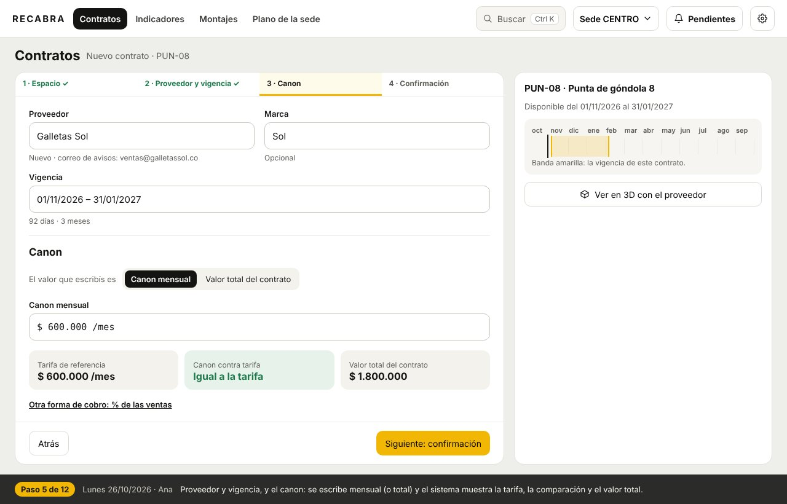

*Dibujo. La misma pantalla muestra el paso 2 y el paso 3.*

- [ ] Proveedor con autocompletado (Tab); correo de avisos del proveedor
- [ ] Marca (opcional)
- [ ] Vigencia ya puesta desde la pregunta inicial; editable con atajos y temporadas

### Nuevo contrato · paso 3: canon

**Estado:** existe (se reordena).

- [ ] Escribir canon mensual o valor total del contrato (el sistema calcula el otro)
- [ ] Tarifa de referencia al lado, la comparación («Igual a la tarifa», «bajo la tarifa») y el valor total
- [ ] Volver a la tarifa
- [ ] Otra forma de cobro: % de las ventas, con corte cada mes o al final

### Nuevo contrato · paso 4: confirmación

El contrato leído como una frase antes de guardarlo. **Estado:** cambia.

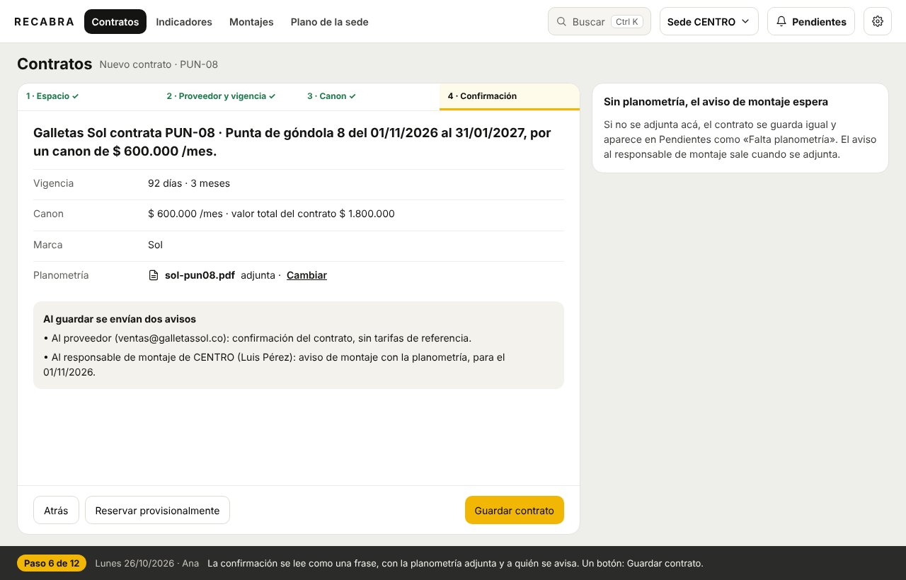

*Dibujo.*

- [ ] Resumen en una frase: proveedor, espacio, fechas, canon
- [ ] Planometría: adjuntar (imagen o PDF), cambiar
- [ ] A quién se avisa: proveedor (sin tarifas), responsable comercial, responsable de montaje; nota opcional para el proveedor
- [ ] Guardar contrato
- [ ] Reservar provisionalmente hasta una fecha de caducidad
- [ ] Atrás · Empezar de nuevo

### Contrato guardado

Qué pasa después de guardar. **Estado:** cambia.

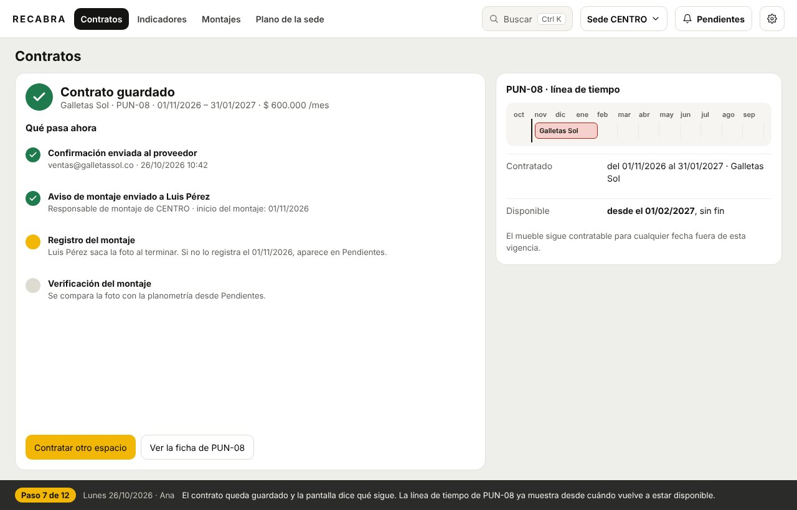

*Dibujo.*

- [ ] Confirmación con el resumen
- [ ] «Qué pasa ahora»: confirmación enviada al proveedor, aviso de montaje enviado (o esperando la planometría o la zona), registro del montaje, verificación
- [ ] Línea de tiempo del espacio con la nueva vigencia y desde cuándo vuelve a estar disponible
- [ ] Contratar otro espacio · Ver la ficha

### Editar, renovar y cancelar

Desde la ficha del espacio o desde Pendientes. **Estado:** existe (se reubica).

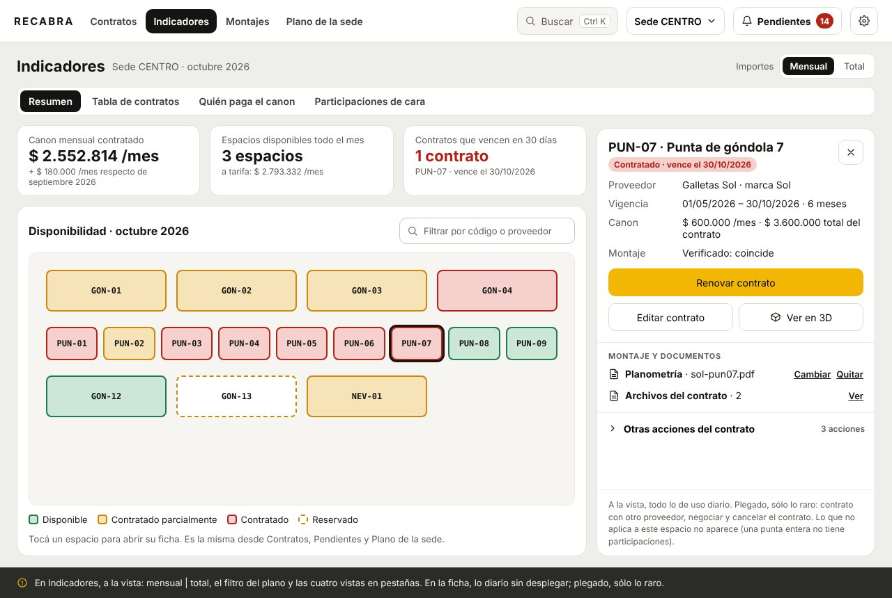

*Dibujo.*

- [ ] Editar contrato (y el próximo, si lo hay): salir sin cambios o «Guardar cambios y reenviar» con confirmación de destinatarios
- [ ] Renovar contrato: abre un contrato nuevo con los datos del actual
- [ ] Contrato con otro proveedor · negociar el espacio
- [ ] Confirmar o cancelar una reserva provisional
- [ ] Cancelar el contrato, con confirmación
- [ ] Contratar lo disponible de una cara o de una parte

### Cargar contratos desde planilla

Varios contratos de una vez, sólo para muebles que se venden enteros. **Estado:** existe.

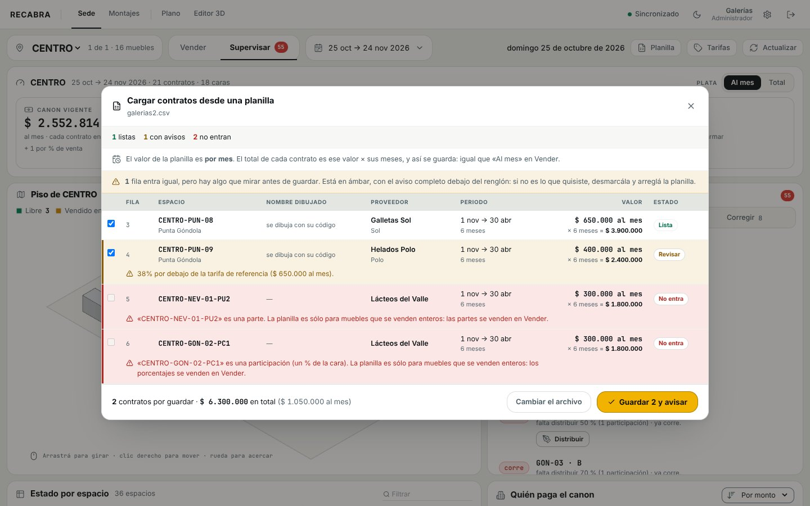

*Captura del sistema actual.*

- [ ] Descargar la plantilla (.xlsx) con las instrucciones
- [ ] Subir .xlsx, .xls o .csv; cambiar el archivo
- [ ] Revisar fila por fila: valor al mes × meses = total, sólo enteros, contra la tarifa; desmarcar filas
- [ ] «Guardar N y avisar»; pantalla final con lo guardado, los avisos y lo que no se pudo

### Ver en 3D con el proveedor

La propuesta delante del proveedor, sin precios ajenos. **Estado:** existe (se reubica).

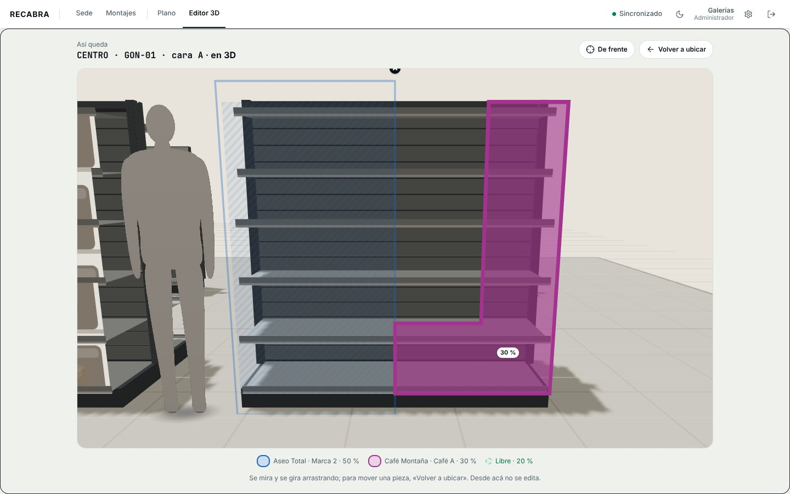

*Captura del sistema actual.*

- [ ] Visor encima del contrato: cambiar de cara, tomas, «Hoy» / «Con {proveedor}», pantalla completa, volver al contrato
- [ ] Probar un producto: buscar, elegir, quitar, cambiar de proveedor
- [ ] Subir un producto (foto del frente, nombre)
- [ ] Bajar la propuesta (lámina con el antes y el después)

## Plano de la sede

Donde se arma el supermercado: el plano 2D y el 3D en un solo módulo, con un selector 2D | 3D. Reemplaza las pestañas Plano y Editor 3D.

### Contorno de la sede

El primer paso de una sede vacía. **Estado:** nueva (hoy el sistema no guarda la entrada).

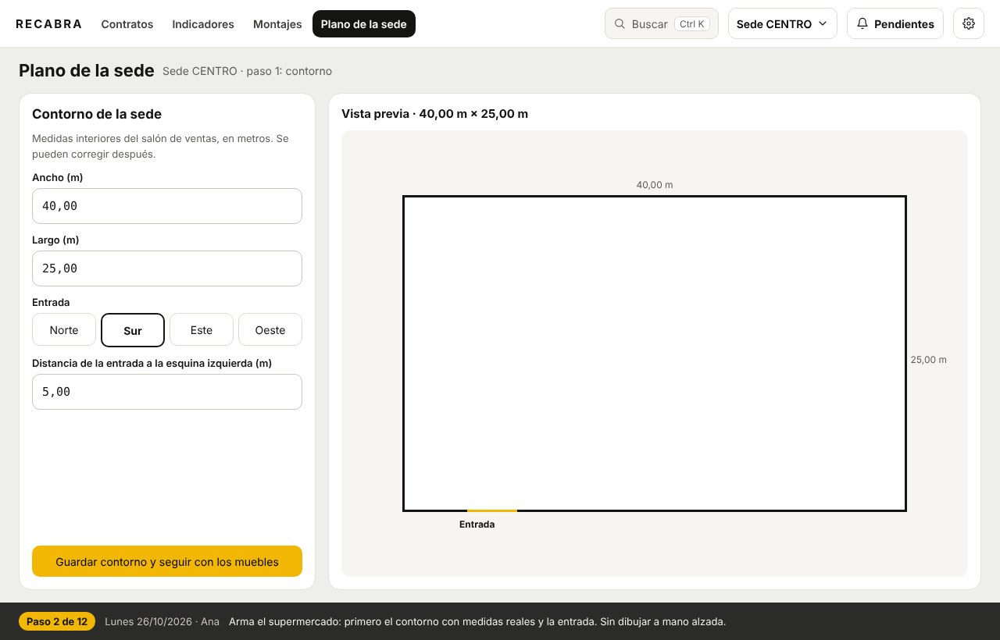

*Dibujo.*

- [ ] Ancho y largo del salón de ventas, en metros
- [ ] Lado de la entrada (norte, sur, este, oeste) y distancia a la esquina
- [ ] Vista previa a escala
- [ ] «Guardar contorno y seguir con los muebles»; corregir después
- [ ] Plano vacío: «Dibujar el plano»

### Plano 2D: muebles

Colocar y editar los muebles a escala. **Estado:** existe (cambia la barra y el panel).

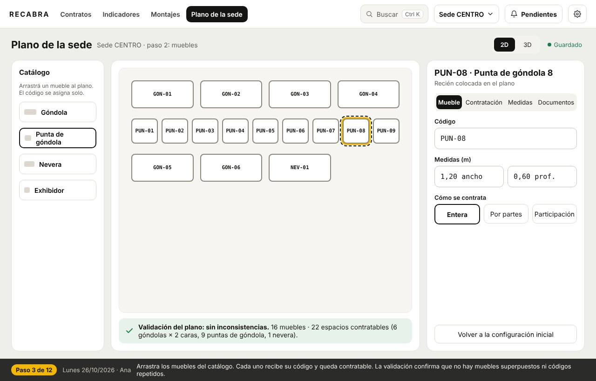

*Dibujo.*

- [ ] Modo ver / modo editar
- [ ] Catálogo por familias: colocar un mueble o un modelo de fábrica arrastrándolo; buscar; plegar; «Ver el catálogo completo»
- [ ] Código asignado solo al colocar un mueble
- [ ] Barra con nombre: Deshacer · Rehacer · Rotar · Duplicar · Eliminar
- [ ] Mover, copiar, pegar, elegir varios (arrastrar, Shift + clic, teclado)
- [ ] Selección múltiple: contratable sí / no, eliminar N elementos
- [ ] Zoom (−, 100 %, +), centrar en todo, mostrar los códigos, pantalla completa
- [ ] Buscar y filtrar en el plano por disponibilidad
- [ ] Estado «Guardado» a la vista
- [ ] Validación del plano a la vista con su conteo: códigos repetidos, muebles superpuestos, pasillos angostos, negociados con otro código; «Tocar para ir»
- [ ] Resultado: «16 muebles · 22 espacios contratables»
- [ ] «Más»: atajos de teclado

### Ficha del mueble

Todo lo del mueble en 4 pestañas, al tocarlo en el plano. **Estado:** cambia (hoy es un panel largo).

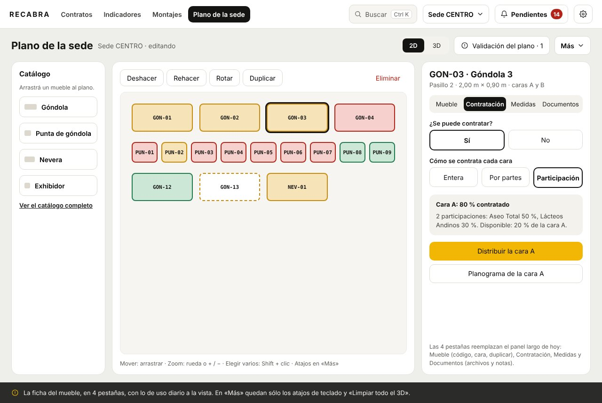

*Dibujo.*

- [ ] Encabezado: código · nombre, pasillo, medidas, caras
- [ ] Pestaña Mueble: cambiar el código (con «Intercambiar» si ya existe), usar la sede del plano, cara A/B, duplicar, eliminar
- [ ] Pestaña Contratación: ¿se puede contratar? (sí / no); cómo se contrata cada cara (entera · por partes · por participación), fijar N partes, aplicar a todas las de la sede, usar lo de la ficha; estado a mano (mantenimiento)
- [ ] Pestaña Contratación con contrato: lo contratado, lo disponible, Distribuir la cara, Planograma de la cara, Contratar
- [ ] Pestaña Medidas: ancho, profundidad, alto, entrepaños (+ / −), módulo
- [ ] Pestaña Documentos: subir y abrir archivos (pdf, xls, csv, imágenes), foto de la cara, nota del contrato y nota del espacio
- [ ] Espacios internos (slots) del mueble: proveedor, categoría, canon, fechas

### Plano 3D

La sede en 3D, para mostrarla y para la reunión con el proveedor. **Estado:** existe (se ordena la barra).

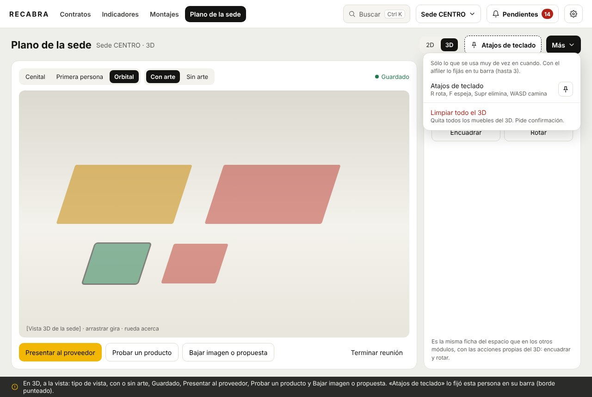

*Dibujo.*

- [ ] Vista: Cenital · Primera persona · Orbital (WASD para caminar)
- [ ] Con arte | Sin arte
- [ ] Estado «Guardado» y Guardar
- [ ] Presentar al proveedor · Terminar reunión (quita las pruebas)
- [ ] Probar un producto: proveedor, lista, probar otro, quitar, medidas
- [ ] Panel de prueba: subir el arte de un producto, mostrar al proveedor, encuadrar esta cara, guardar / reemplazar / olvidar la vista
- [ ] Rejillas a mano (automáticas, de fábrica, a mano; por entrepaño; surtido) — plegado
- [ ] Bajar imagen (PNG) o propuesta (antes y después)
- [ ] Mueble elegido: rotar (R), espejar (F), eliminar (Supr), nombre con intercambio; misma ficha del espacio con Encuadrar y Rotar
- [ ] Colocar muebles desde el catálogo y leyenda de estados
- [ ] «Más»: limpiar todo el 3D (con confirmación)

### Distribución de una cara por participación

Ubicar en la cara la zona de cada marca contratada por porcentaje. **Estado:** existe.

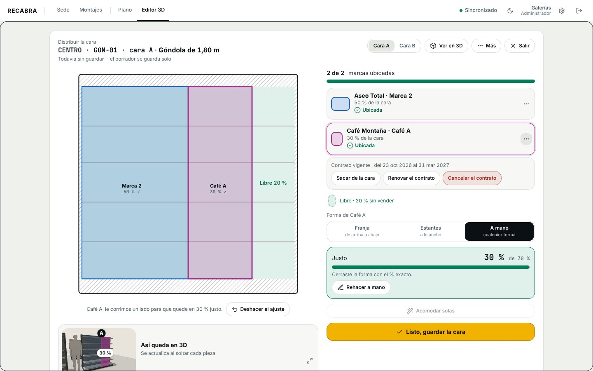

*Captura del sistema actual.*

- [ ] Cara A/B; Ver en 3D / Volver a ubicar; centrar la cara; miniatura «Así queda en 3D»
- [ ] Arrastrar piezas; forma Franja · Estantes · A mano; trazo (borrar puntos, rehacer); «Acomodar solas»
- [ ] Menú de una pieza: achicar a / dejar en X %, primer hueco libre, a la izquierda / derecha, sacar de la cara
- [ ] Menú de una pieza: renovar el contrato, pasar a contrato, cambiar o cancelar la reserva
- [ ] Formulario de participación (reserva provisional o contrato)
- [ ] «Listo, guardar la cara» con resumen; salir guardando o no
- [ ] «Más»: deshacer, rehacer, copiar de la otra cara, qué pasó con esta cara (historial), sacar todas las piezas, descartar mis cambios o el borrador
- [ ] Pasar el mueble a participación
- [ ] Recuperar lo que no se guardó · conflicto con otra persona («Traer lo nuevo / Usar lo mío»)

## Planograma

Qué va en cada lugar de una cara: en muebles que no se venden y en lo disponible de los que sí. Se entra desde la ficha del mueble o del espacio; no tiene contratos, proveedor ni precio.

### Planificar la cara

La cara a escala, con los destinos a la izquierda y la revisión a la derecha. **Estado:** existe (cambia la entrada).

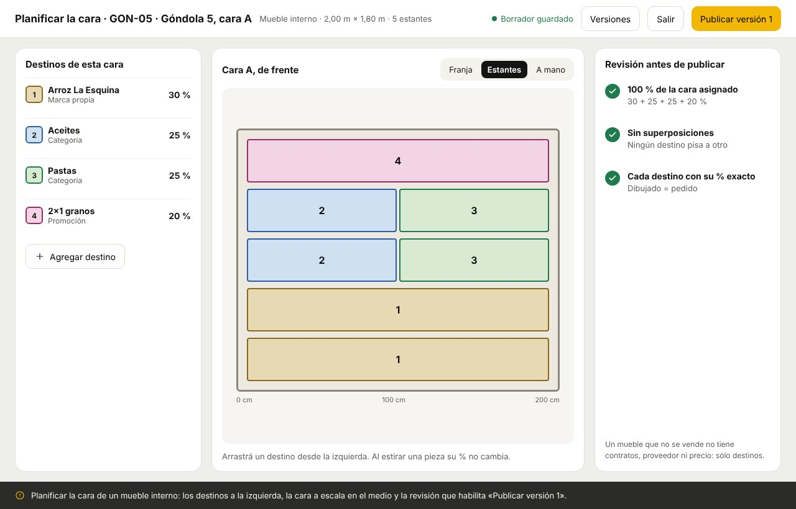

*Dibujo.*

- [ ] Encabezado: código, cara, medidas, estantes; «Borrador guardado» (se guarda solo a los 20 s)
- [ ] Destinos de la cara con su tipo y su %
- [ ] Agregar destino: nombre, tipo (marca propia, categoría, producto o grupo, promoción, otro), %, cómo se monta, código en tu sistema, guardarlo en los destinos de la sede
- [ ] Arrastrar cada destino a la cara; forma Franja · Estantes · A mano; estirar sin cambiar el %; «Acomodar solos»
- [ ] Menú del destino: cambiar destino, quitar de la cara, ubicar o achicar
- [ ] Usar lo disponible con un destino (en muebles que se venden; lo vendido en gris, con candado)
- [ ] Revisión antes de publicar: 100 % asignado, sin superposiciones, cada destino con su % exacto, sin pisar lo vendido
- [ ] «Más»: deshacer, rehacer, vaciar, descartar mis cambios o el borrador
- [ ] Salir (pregunta si hay cambios)

### Publicar versión

Deja la versión fija y lista para montar. **Estado:** existe.

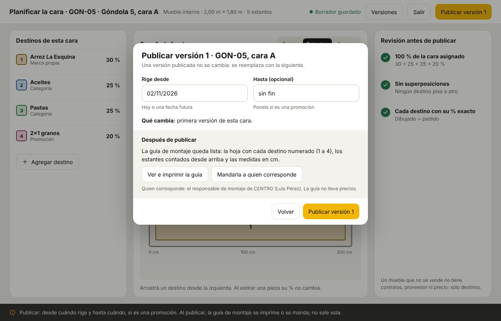

*Dibujo.*

- [ ] Rige desde (hoy o futura) y hasta (opcional, para una promoción)
- [ ] Qué cambia contra la versión vigente
- [ ] Publicar versión N (una publicada no se cambia: se reemplaza)
- [ ] Después de publicar: Ver e imprimir la guía · Mandarla a quien corresponde

### Versiones

La historia de la cara, con el estado de montaje de cada versión. **Estado:** existe (pasa a botón a la vista).

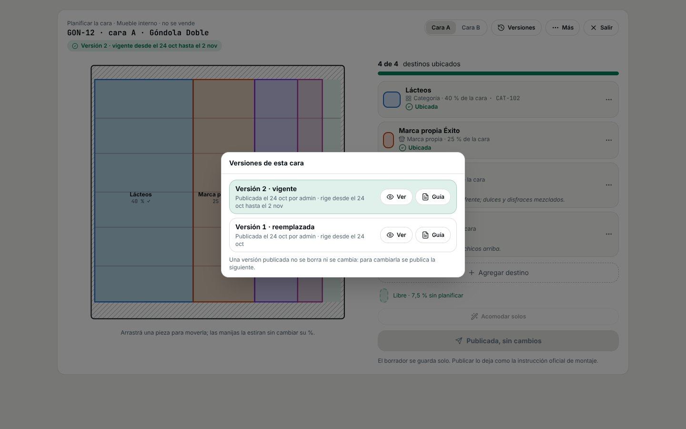

*Captura del sistema actual.*

- [ ] Lista de versiones: programada, vigente (o vencida hace N días), reemplazada
- [ ] Estado por versión: sin montar, montada y falta revisar, no se pudo, coincide, no coincide
- [ ] Ver una versión sin poder cambiarla · abrir su guía · abrir su revisión
- [ ] Quién planifica y publica: sólo administración, o también el equipo en muebles internos

### Guía de montaje

La hoja de una versión, para imprimir o mandar. **Estado:** existe.

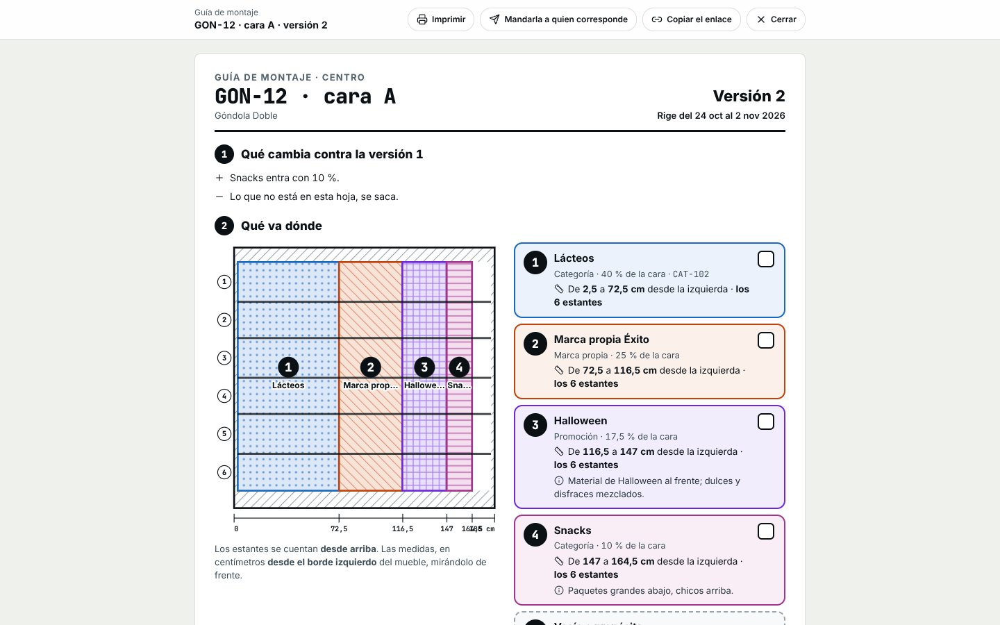

*Captura del sistema actual.*

- [ ] Encabezado: sede, código y cara, versión y vigencia, aviso si no es la de hoy
- [ ] Paso 1 · Qué cambia contra la versión anterior
- [ ] Paso 2 · Qué va dónde: la cara con cada destino numerado, estantes contados desde arriba, regla en cm, una ficha por destino, vacíos a propósito, lo ya asignado sin marcas
- [ ] Paso 3 · Al terminar: casillas y firma
- [ ] Imprimir (A4, paleta propia para blanco y negro)
- [ ] Mandarla a quien corresponde (responsable de montaje de la sede, administración, otros correos), sin precios
- [ ] Copiar el enlace

## Montajes

Que lo contratado y lo planificado esté en la tienda como se pidió. Dos clases de montaje, contrato y planograma, en una sola lista; la verificación del montaje de un contrato es nueva.

### Lista de montajes

Todos los montajes de la sede, por fecha de inicio. **Estado:** cambia (hoy sólo lista lo que falta montar).

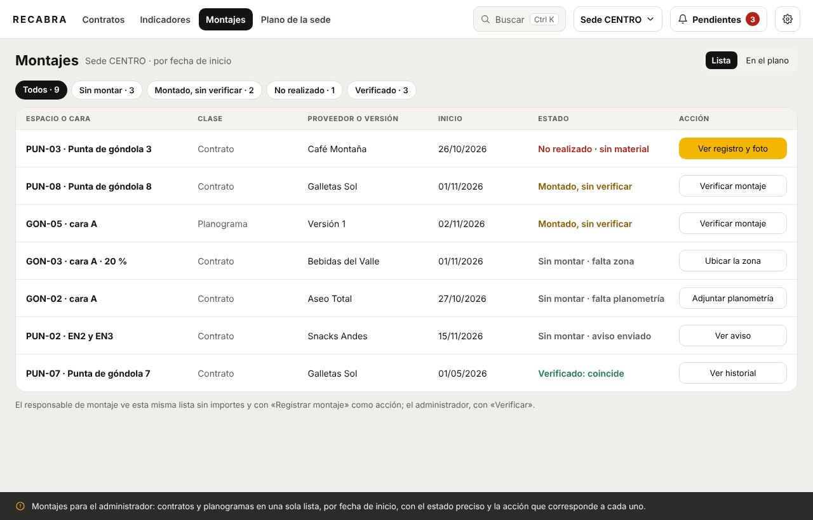

*Dibujo.*

- [ ] Filtros: Todos · Sin montar · Montado, sin verificar · No realizado · Verificado, con conteo
- [ ] Ver como Lista · En el plano
- [ ] Por fila: espacio o cara, clase (contrato o planograma), proveedor o versión, inicio, estado preciso
- [ ] Estados precisos: sin montar · falta planometría · falta zona · aviso enviado · montado, sin verificar · no realizado (con motivo) · verificado: coincide · verificado: no coincide
- [ ] Acción por fila: Ver registro y foto · Verificar montaje · Ubicar la zona · Adjuntar planometría · Ver aviso · Ver historial
- [ ] Para el responsable de montaje: la misma lista sin importes, con «Registrar montaje»
- [ ] Resumen de montajes (enlace a Indicadores)

### Aviso de montaje en el teléfono

Lo que abre quien monta desde el correo, sin contraseña. **Estado:** existe.

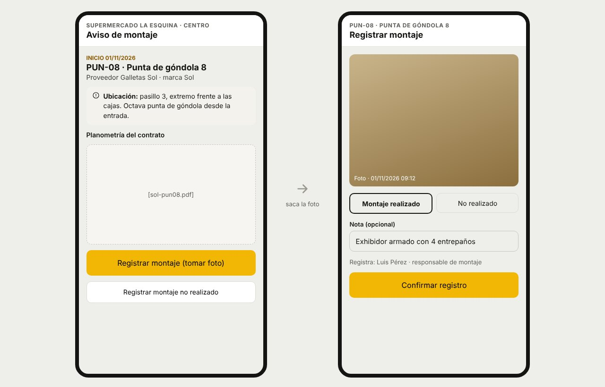

*Dibujo. A la izquierda el aviso; a la derecha el registro del montaje (pantalla siguiente).*

- [ ] Enlace del correo, sin montos; abre ese espacio directamente
- [ ] Lista «Para montar hoy» ordenada por urgencia (lo que ya empezó primero)
- [ ] Mapa de la sede con el mueble señalado y la ubicación escrita
- [ ] Planometría del contrato; en una participación, sólo su zona
- [ ] «Entrar a RECABRA» si tiene cuenta

### Registrar montaje

El registro con foto al terminar. **Estado:** existe.

- [ ] «Registrar montaje (tomar foto)»: cámara o galería
- [ ] Montaje realizado · No realizado
- [ ] Motivo obligatorio si no se pudo: el proveedor no entregó el material, no llegó el producto, el espacio está ocupado por otra cosa, otro motivo
- [ ] Quién registra y nota opcional
- [ ] Confirmar registro · Corregir lo que acabo de registrar

### Guía de montaje por enlace

La hoja de un planograma en el teléfono de quien monta. **Estado:** existe.

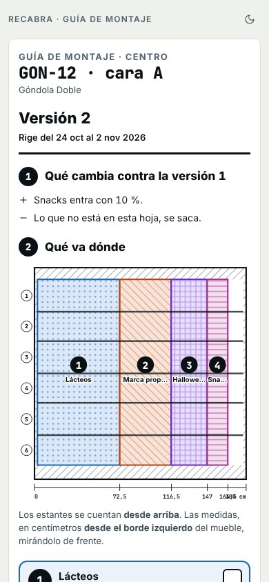

*Captura del sistema actual.*

- [ ] Marcar cada número como «Listo»
- [ ] «¿Cómo quedó?»: Quedó montada (foto opcional) · No se pudo (motivo y nota)
- [ ] Aviso arriba si hay que corregir («el 2 y el 3 quedaron mal»)
- [ ] Imprimir la hoja

### Verificar el montaje de un contrato

Comparar lo que se pidió con lo que quedó. **Estado:** nueva.

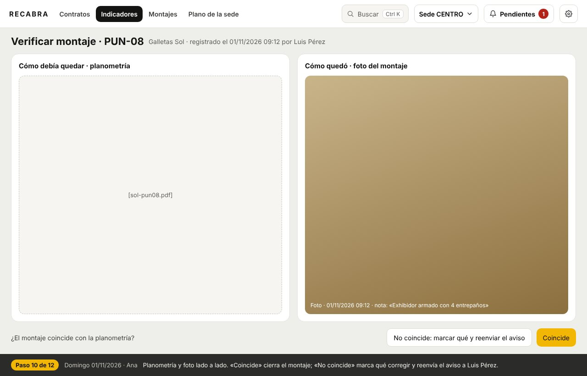

*Dibujo.*

- [ ] Planometría al lado de la foto del montaje, con fecha, hora, quién registró y nota
- [ ] Coincide
- [ ] No coincide: nota de qué corregir y reenviar el aviso de montaje
- [ ] Queda quién verificó y cuándo

### Verificar el montaje de un planograma

La guía numerada al lado de las fotos. **Estado:** existe.

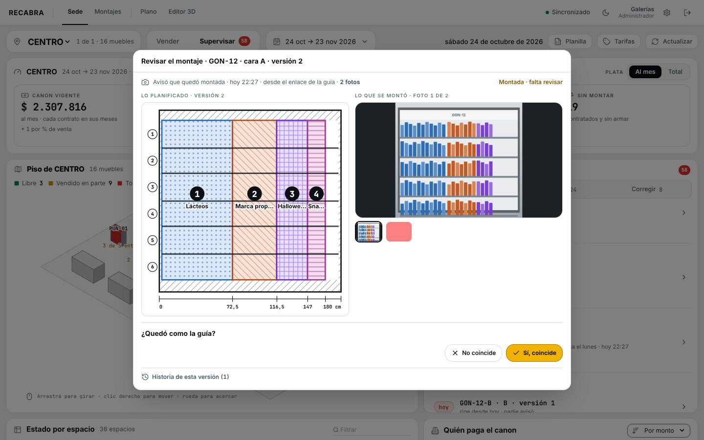

*Captura del sistema actual.*

- [ ] Lo planificado (la cara de la guía con sus números) al lado de las fotos nuevas
- [ ] Sí, coincide · sin foto nueva: «Lo vi en la tienda: coincide»
- [ ] No coincide: tocar los números que quedaron mal u «otra cosa», qué hay que corregir, mandar la guía de nuevo
- [ ] Historia de la versión (avisos y revisiones)

### Resolver un montaje no realizado

Qué hacer según el motivo. **Estado:** cambia.

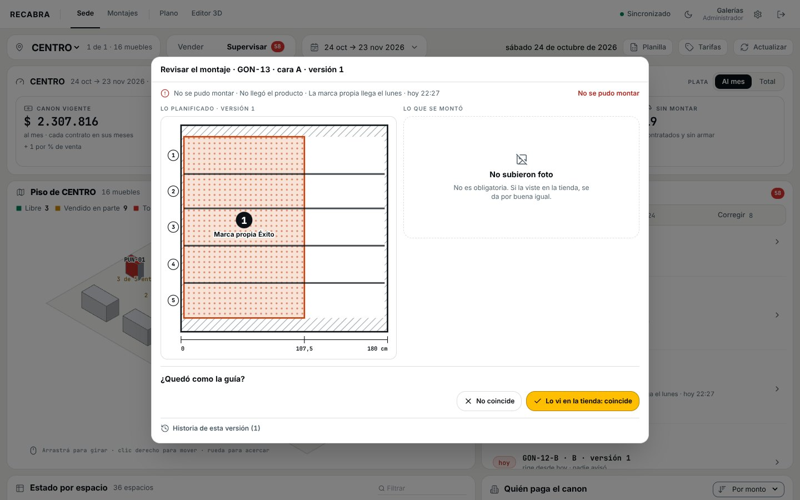

*Captura del sistema actual.*

- [ ] Ver el registro, el motivo y la foto
- [ ] Según el motivo: reclamar al proveedor, liberar el espacio ocupado, reenviar el aviso con nueva fecha
- [ ] Vuelve a «sin montar» o se cierra

## Ajustes

La configuración, en una pantalla con menú lateral por tema. Junta lo que hoy está en el engranaje, en botones de la barra de Sede, en el Plano y en direcciones sin enlace (/taller, /renumerar). **Estado:** nueva como pantalla; casi todas sus partes existen.

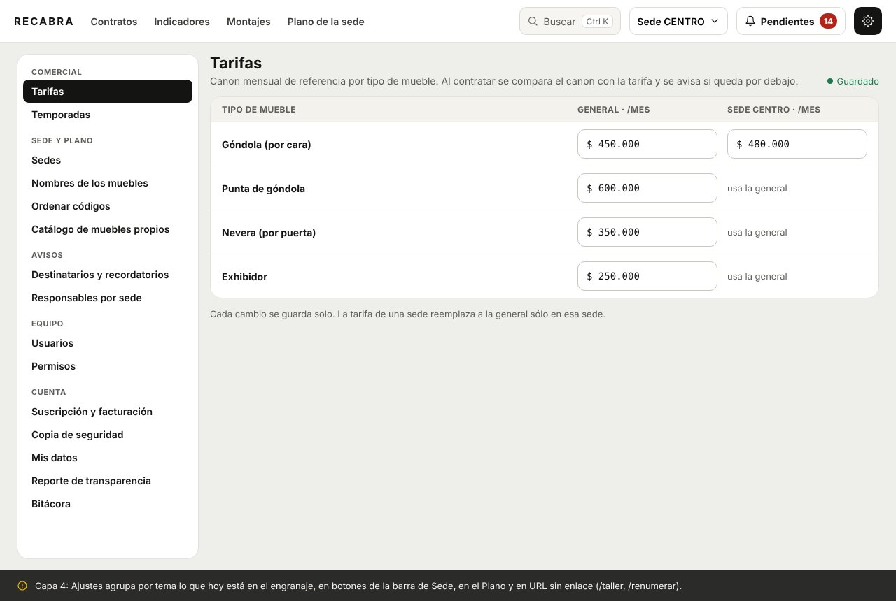

*Dibujo. La sección Equipo se ve en «Invitación al equipo».*

### Comercial

- [ ] Tarifas: canon mensual de referencia por tipo de mueble, general y por sede; se guarda solo
- [ ] Temporadas: fechas de cada temporada, días antes y después, «se vende», volver al valor sugerido
- [ ] Metas por sede: ocupación y canon ÷ tarifa, con sus umbrales (nuevo)

### Sede y plano

- [ ] Sedes: crear, renombrar, eliminar (con confirmación)
- [ ] Nombres de los muebles: cómo se llama cada familia en este supermercado
- [ ] Ordenar códigos (renumerar): alcance todas o una sede, recalcular, imprimir el informe, aplicar
- [ ] Catálogo de muebles propios (hoy /taller): crear, editar, retirar o reactivar fichas; mirar un mueble girable con carta de color; cómo se vende cada ficha

### Avisos

- [ ] Destinatarios y recordatorios: correos, días de recordatorio antes del vencimiento
- [ ] Enviar correo de prueba
- [ ] Responsables por sede: comercial, administración y montaje

### Equipo

- [ ] Usuarios: invitar por correo con rol (Trabajador, Administrador, Dueño), lo que puede cada rol escrito al lado
- [ ] Ver miembros e invitaciones pendientes, con último ingreso y vencimiento
- [ ] Activar o desactivar un miembro
- [ ] Permisos: quién planifica y publica planogramas (hoy sin pantalla)

### Cuenta

- [ ] Suscripción y facturación: estado, lo pactado, próxima cuenta de cobro, cómo pagar, pagos registrados; datos de facturación
- [ ] Copia de seguridad (ZIP de todo)
- [ ] Mis datos: descargarlos y solicitar la supresión
- [ ] Reporte de transparencia (imprimir, PDF, JSON)
- [ ] Bitácora: filtro por acción, actualizar
- [ ] Configuración inicial: volver a mostrarla

## Sin cambios y decisiones abiertas

La consola de plataforma del operador queda como está: elegir el mes, capítulos, cola de llamadas, estados y cobros de clientes, cobranza, supresiones, sesión de asesoría e informe para el cliente.

Lo que falta decidir antes de implementar:

- [ ] Metas: 90 % de ocupación y 95 % de canon ÷ tarifa (ámbar por debajo; rojo bajo 80 % y 85 %), ¿o por sede?
- [ ] Nombres del menú: Contratos · Indicadores · Montajes · Plano de la sede (y si «Vender» se conserva)
- [ ] Importes completos, sin abreviar «M»
- [ ] Orden de implementación (propuesta: Contratos con fechas primero, junto con el Resumen de Indicadores)
- [ ] Una persona nueva que pruebe la primera etapa
